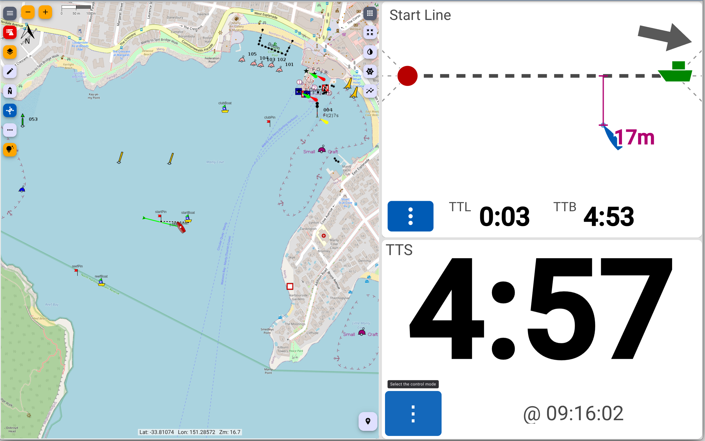

# Signal K Racing Plugin

This plugin adds sail racing relevant data to a Signal K server. It focuses on real-time information useful during the start of a race, such as:
 + A server side race timer that can be displayed on multiple screens and be finely adjusted
 + A mechanism to set and adjust the start line using waypoints and REST commands
 + Calculation of the distance, time to line and time to burn, from the bow
 + Calculation of the TWA for the next leg of the course.

These values can be displayed in Skip/KIP widgets, Freeboard-SK, or other Signal K clients.
There are dedicated widgets for the start timer and line in Skip, and in KIP since 3.5.0.
There is also a webapp to adjust the line, visualise the approach to the line, adjust VMGs, and configure the timer.

*Skip start line view and timer widgets beside Freeboard-SK*

---

## 🚀 Installation

Install `signalk-racer` from the Signal K server's Appstore, then enable and configure it under
Server → Plugin Config. The start line is taken from two waypoints, by default named `startBoat`
and `startPin`, which can be set from Freeboard-SK or by "pinging" the ends from the widgets.

---

## 🔗 Dependencies

### Required
- **[Signal K server](https://github.com/SignalK/signalk-server) 2.x** on Node 18+. Its
  Resources API holds the line's waypoints, its Course API the active route, and its vessel
  settings the GPS offsets and boat length for the
  [bow position](https://github.com/gregw/signalk-racer/wiki/Bow-position) (with the GNSS (CCRP)
  correction of 2.31+ also understood).
- **A GPS**, connected through the server's built in
  [NMEA 2000](https://www.npmjs.com/package/@signalk/n2k-signalk) or
  [NMEA 0183](https://www.npmjs.com/package/@signalk/nmea0183-signalk) support, for the position,
  speed and course over ground.
- **[geolib](https://www.npmjs.com/package/geolib)** and **[uuid](https://www.npmjs.com/package/uuid)**,
  installed automatically with the plugin.

### Optional
Used when present; without them the related values are not published, or a fallback is used:
- **[signalk-polar-management](https://www.npmjs.com/package/signalk-polar-management) 1.5+**,
  with an active polar, to use the boat's polars for the
  [best VMGs](https://github.com/gregw/signalk-racer/wiki/VMG). Racer finds its in-process
  service at run time, so has no npm dependency on it, and works without it.
- **Wind instruments**, through the server's NMEA support, for the true wind direction (the
  line bias and next leg TWA) and speed (the polars). Where they only give apparent wind,
  **[signalk-derived-data](https://www.npmjs.com/package/signalk-derived-data)** works out the
  true wind.
- **A heading sensor and log**, through the server's NMEA support, to place the bow ahead of
  the position and to measure how well the boat sails to its polar without the current.
  Without them, the course and speed over ground are used.
- **[Freeboard-SK](https://www.npmjs.com/package/@signalk/freeboard-sk)**, or another chart
  plotter using the server's Course API, to activate a route for the next leg heading and TWA.
- **[signalk-polar-performance](https://www.npmjs.com/package/signalk-polar-performance)**
  _(future)_, not used yet. Its beat and gybe angles (`performance.beatAngle`,
  `performance.gybeAngle`) will be needed to work out the time and distance to lay a mark.
- **Bearing and distance to the next waypoint** _(future)_, not used yet, for the time and
  distance to lay. These can come from the server's Course API (set by Freeboard-SK or another
  plotter), or from a chart plotter's NMEA feed (e.g. 0183 `RMB`/`BWC`, NMEA 2000 PGN 129284)
  through the server's NMEA support.

### Recommended
- **[Skip](https://www.npmjs.com/package/@halos-org/skip)** or **[KIP](https://www.npmjs.com/package/@mxtommy/kip)**
  (3.5.0+), for the start timer and line widgets.
- **[Freeboard-SK](https://www.npmjs.com/package/@signalk/freeboard-sk)**, to set the line's
  waypoints on a chart and see the line drawn.

---

## 📖 Documentation

The details are in the [wiki](https://github.com/gregw/signalk-racer/wiki):

- [Signal K Paths](https://github.com/gregw/signalk-racer/wiki/Signal-K-Paths) published by the plugin
- [Configuration](https://github.com/gregw/signalk-racer/wiki/Configuration) parameters
- [Algorithms](https://github.com/gregw/signalk-racer/wiki/Algorithms) for the line, distance, time to line and time to burn
- [Bow position](https://github.com/gregw/signalk-racer/wiki/Bow-position) and the server's GNSS (CCRP) correction
- [Webapp](https://github.com/gregw/signalk-racer/wiki/Webapp) start line visualisation
- [Skip Widgets](https://github.com/gregw/signalk-racer/wiki/Skip-Widgets)
- [API](https://github.com/gregw/signalk-racer/wiki/API) for setting the line, timer and VMGs
- [Development](https://github.com/gregw/signalk-racer/wiki/Development) and [Releasing](https://github.com/gregw/signalk-racer/wiki/Releasing)

Changes in each release are in [ReleaseNotes.md](ReleaseNotes.md).

---

## 🧪 Future Plans

- **Laylines** and distance/time to them

---

## 📬 Feedback

Bug reports and suggestions are welcome at
[https://github.com/gregw/signalk-racer/issues](https://github.com/gregw/signalk-racer/issues)
